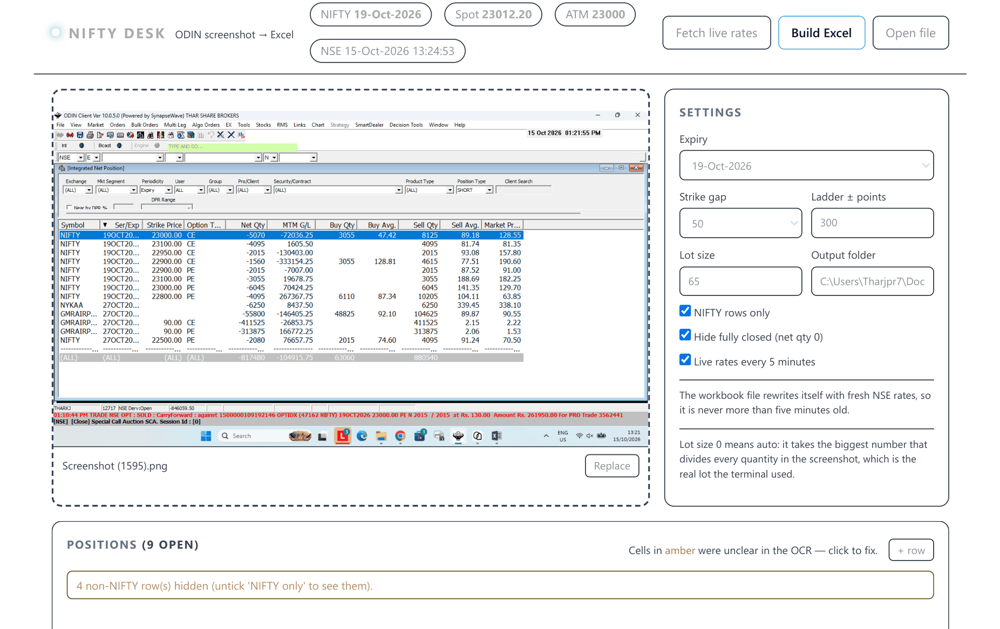
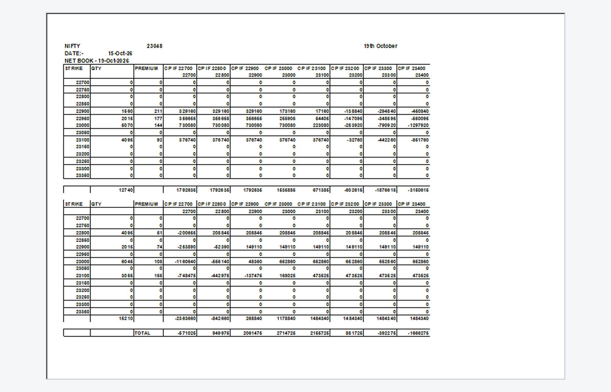

# Nifty Desk

**Drop a screenshot of your broker's net-position grid. Get back a live, ready-to-use NIFTY
options workbook.**

[](LICENSE)
[](https://github.com/85599/nifty-desk/releases/latest)
[](#run-it)
[](requirements.txt)


---

## Why this exists

> **Everyone is telling you how to trade. Nobody is telling you how safe you are.**

Anyone can show you a setup, a tip, a "sure-shot" strangle. Very few tools show you, honestly and
in real time, *what happens to your book if the market sits exactly where it is — or moves 500
points against you*. That gap is where accounts blow up.

Nifty Desk is on the safety side of that line. It takes the positions you already hold and lays
them out so the risk is impossible to ignore:

- **Live premiums and live P&L** on every leg, refreshed from NSE so the numbers are never stale.
- A **`CP IF <spot>` grid** that recomputes your whole book's value at every expiry spot — you can
  see the loss before the market shows it to you.
- **Breakeven** and per-expiry pages, so nothing is hidden in a single blended number.

It does not place orders and it does not promise returns. It makes the risk visible. That is the
whole point.

---

## How it works



1. **Screenshot in** — drag & drop or `Ctrl+V`. Windows OCR reads the grid locally; the image never
   leaves your machine.
2. **Positions parsed** — non-NIFTY rows and fully-closed rows are filtered out; lot size is
   auto-detected from the quantities. If OCR loses an option's `CE/PE` type, it is recovered from the
   sibling leg or the live NSE price.
3. **Live rates** — press *Fetch rates* to pull premiums + spot from the public NSE option chain
   (no API key). The workbook then refreshes itself every 5 minutes.
4. **Excel out** — one `Sheet1` block per expiry, laid out exactly like a hand-made book.

---

## Reading the sheet — the sign convention

This is the one thing that trips people up, so it is written into the tool:

- **A SELL (short) quantity is written as a positive number.**
- **A BUY (long) quantity is written as a negative number.**

The ODIN terminal shows shorts as a minus Net Qty; the sheet flips that to a positive Qty with a
`Side` column, and the `CP IF` grid uses the sell-positive / buy-negative sign above so the P&L
formulas come out right. Premiums are written as **round whole numbers**, not decimal points.

Each expiry block has: a full `STRIKE / QTY / PREMIUM` ladder at a 50-point gap (zero rows included,
so you can type into them by hand), `CP IF <spot>` scenario columns at a 100-point gap, a CE section,
a PE section, a futures line, and a grand `TOTAL`. Every scenario cell is a live IF formula, so
editing a quantity or a rate recalculates the whole grid. Each expiry prints on its own page.

## The workbook, opened in Excel

This is real generated output — the CE and PE blocks for one expiry, live `CP IF` scenario grid,
zero rows you can type into, and the grand `TOTAL`:



---

## Run it

### Option 1 — no Python needed

Download `NiftyDesk-win64-v1.0.1.zip` from the
[latest release](https://github.com/85599/nifty-desk/releases/latest), unzip it anywhere
(Desktop is fine) and double-click `NiftyDesk.exe`. A console window opens, your browser tab
follows a second later. Close the console window to stop it.

Your workbooks land in an `output` folder next to the exe, and settings persist in
`config.json` beside it. If you put the exe somewhere read-only, both move to
`%LOCALAPPDATA%\NiftyDesk`.

**First run, Windows says "Windows protected your PC"?** That's SmartScreen, not a virus — the
exe is unsigned because code-signing certificates cost money. Click **More info → Run anyway**.
The source is right here, so you can also build it yourself with `build_exe.bat`.

### Option 2 — from source

```bash
pip install -r requirements.txt
cp config.example.json config.json      # optional; sensible defaults are built in
python server.py
```

Then open `http://127.0.0.1:8765/`. On Windows you can also double-click `Run Nifty Desk.bat`.
To produce your own exe: `pip install pyinstaller` then run `build_exe.bat`.

## Config

`config.json` (git-ignored) holds your working settings:

| key | meaning |
| --- | --- |
| `symbol` | instrument to keep rows for (default `NIFTY`) |
| `only_symbol` | hide non-matching rows |
| `drop_closed` | hide rows with net qty 0 |
| `step` | strike gap (50 or 100) |
| `span` | how far above/below spot the ladder reaches |
| `lot` | lot size; `0` = auto-detect from the screenshot |
| `output_dir` | where workbooks are written; blank = `./output` |

## Notes

- Requires Windows (uses the built-in Windows OCR via PowerShell).
- **Private by design:** no account credentials, and no data leaves your machine except the public
  NSE quote request. Your positions and screenshots stay local.
- This is a risk-visibility and bookkeeping tool, not investment advice. Trading in derivatives
  carries substantial risk.

## License

MIT — see [LICENSE](LICENSE). Free to use, modify and redistribute. No warranty, and nothing here is
investment advice.
